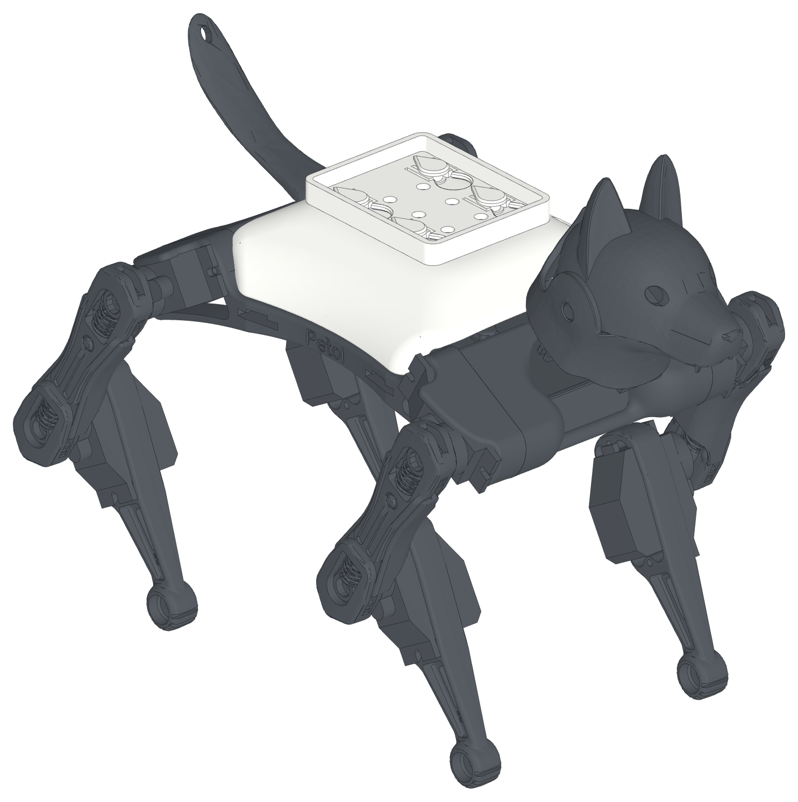
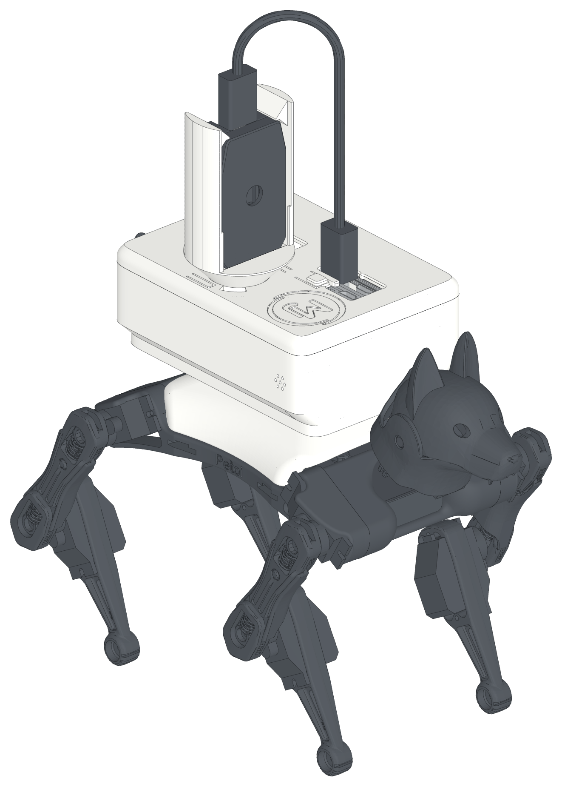
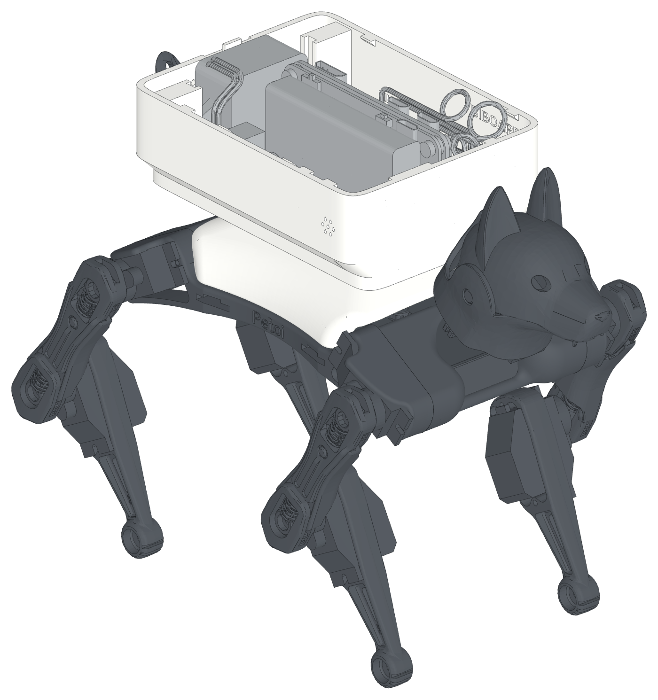

# Bittle X Platform

> This repository is only the 3D model for the Bittle X hardware and software of
> [LineChef](https://github.com/LineChef). His project is
> [LineChef/BittleX](https://github.com/LineChef/BittleX), and its documentation
> site is [LineChef/react-bittlex](https://github.com/LineChef/react-bittlex).
> The logo on the panel top is the LineChef avatar.

Click-on add-ons for the Petoi Bittle X robot dog. Print a new back cover
with 4 teardrop pegs, then put hardware on your robot without tools, glue or tape.

**[Website and 3D viewer](https://beetlebugorg.github.io/bittlex/)** ·
[Platform spec (PDF)](bittle_platform/bittle_platform_spec.pdf) ·
[Pi add-on guide (PDF)](bittle_pi_addon/bittle_pi_addon_guide.pdf)

<picture>
  <source media="(prefers-color-scheme: dark)" srcset="bittle_platform/doc/iso/platform-dark.png">
  
</picture>

## The platform

The platform is the stock Petoi back cover with 4 teardrop pegs on its flat top. It
goes on the robot in place of the stock cover. The inside of the cover does
not change, so the BiBoard and the touch sensor fit as before. A notch in the
front-left edge lets the head camera plug out.

- **Tool-free mount.** Put an add-on on the pegs, slide it 7 mm forward,
  and it clicks into place. Slide it rearward, away from the head, to remove
  it closed. Two spring beams at each peg push it into a V stop, so it is
  centered and does not rattle.
- **One direction only.** The peg heads and the keyholes are teardrops.
  Turned the wrong way, an add-on does not go on.
- **Centered pegs.** The 24 x 20 mm peg pattern is on the center line of
  the robot.
- **Open interface.** The spec has every number that you need.
  [`interface.json`](bittle_platform/interface.json) has the same numbers
  for scripts and LLMs.
- **Starter plate.** Begin a new add-on from
  [`starter_plate.step`](bittle_platform/cad/starter_plate.step). It has the
  keyholes and the click springs.
- **Keep-out model.** [`keepout.stl`](bittle_platform/stl/installed/keepout.stl)
  shows the space that an add-on must keep clear: the robot, the peg heads
  and the BiBoard header.

## Example: the Pi add-on

<picture>
  <source media="(prefers-color-scheme: dark)" srcset="bittle_pi_addon/doc/iso/hero-dark.png">
  
</picture>

A Raspberry Pi with a battery, a speaker and a microphone, in one rounded box
that clicks onto the platform.

- Raspberry Pi Zero 2 W with a PiSugar 2 battery (1200 mAh), on its long edge over the robot center, ports up
- NS4168 I2S amp and a 3 W speaker at the rear, sound out of the rear grille
- SPH0645 I2S microphone on the right side near the front, away from the speaker
- One-piece body: it clicks onto the platform empty, then every part goes in from the top
- Serial link to the BiBoard: the Dupont plugs go onto the header at the front left, and all the wires stay inside
- A slide-on top panel with openings shaped to the plugs and the power switch, a large button and a logo inlay
- The Petoi AI Vision Module on a round twist-lock mount in the panel top. Turn it end for end to point the lens to the rear. A lower mount in front of the body is for use with the head off
- All printed parts print without supports

<picture>
  <source media="(prefers-color-scheme: dark)" srcset="bittle_pi_addon/doc/iso/open-dark.png">
  
</picture>

## Make your own add-on

1. Read the [platform spec](bittle_platform/bittle_platform_spec.pdf). It is
   3 pages.
2. Start from the starter plate, or cut the keyholes into your own plate
   with `keyhole_cutter.step` and `detent_bumps.step`.
3. Keep your part out of `keepout.stl`.
4. Print the plate face down on the bed.

## Repository

| Folder | Content |
|---|---|
| [`bittle_platform/`](bittle_platform) | The platform: spec, print files, CAD, build script |
| [`bittle_pi_addon/`](bittle_pi_addon) | The Pi add-on: build guide, print files, CAD, build script |
| [`web/`](web), `build_site.py` | The website and the 3D viewer |

The build scripts use [build123d](https://github.com/gumyr/build123d) and
[manifold3d](https://github.com/elalish/manifold). The website build needs
only Python.

## License

Code: MIT. Designs and documents: CC BY 4.0. The Petoi and PiSugar models
have their own terms. See [LICENSE.md](LICENSE.md) and
[ATTRIBUTION.md](ATTRIBUTION.md).
