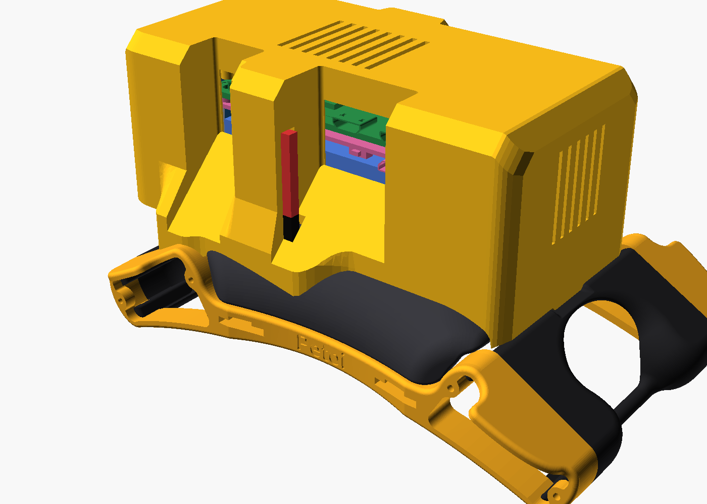
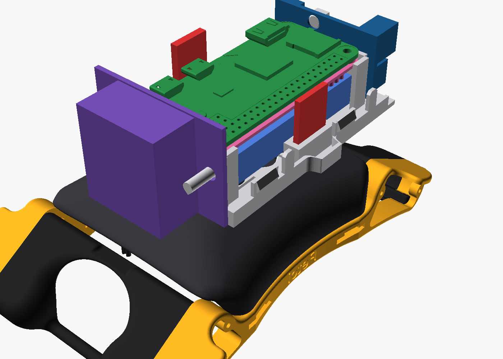

# Bittle X Platform

Click-on add-ons for the Petoi Bittle X robot dog. Print a new back cover
with 4 pegs, then put hardware on your robot without tools, glue or tape.

**[Website and 3D viewer](https://beetlebugorg.github.io/bittlex/)** ·
[Platform spec (PDF)](bittle_platform/bittle_platform_spec.pdf) ·
[Pi add-on guide (PDF)](bittle_pi_addon/bittle_pi_addon_guide.pdf)

## The platform

The platform is the stock Petoi back cover with 4 pegs on its flat top. It
goes on the robot in place of the stock cover. The inside of the cover does
not change, so the BiBoard and the touch sensor fit as before.

- **Tool-free mount.** Put an add-on on the pegs, slide it 7 mm rearward,
  and it clicks into place. Slide it forward to remove it.
- **Centered pegs.** The 24 x 16 mm peg pattern is on the center line of
  the robot.
- **Open interface.** The spec has every number that you need.
  [`interface.json`](bittle_platform/interface.json) has the same numbers
  for scripts and LLMs.
- **Starter plate.** Begin a new add-on from
  [`starter_plate.step`](bittle_platform/cad/starter_plate.step). It has the
  keyholes and the click springs.
- **Keep-out model.** [`keepout.stl`](bittle_platform/stl/installed/keepout.stl)
  shows the space that an add-on must keep clear: the robot, the peg heads
  and the BiBoard header.

## Example: the Pi add-on

A Raspberry Pi with a battery, a speaker and a microphone, in one pod that
clicks onto the platform.

- Raspberry Pi Zero 2 W with a PiSugar 2 battery (1200 mAh)
- NS4168 I2S amp and a 3 W speaker, sound out of the front grille
- SPH0645 I2S microphone on the left side, away from the speaker
- Balanced: the Pi stack is on the center line, and the speaker at the front balances it
- Serial link to the BiBoard through the Pi slot in the cover
- Two open port bays in the right side of the lid: the charge port, the button, the switch, and the Pi USB and mini-HDMI ports are at the bay faces
- A cable slot for the Petoi AI Vision Module camera in the head
- 3 printed parts, all without supports

## Make your own add-on

1. Read the [platform spec](bittle_platform/bittle_platform_spec.pdf). It is
   3 pages.
2. Start from the starter plate, or cut the keyholes into your own plate
   with `keyhole_cutter.step` and `detent_bumps.step`.
3. Keep your part out of `keepout.stl`.
4. Print the plate face down on the bed.

## Repository

| Folder | Content |
|---|---|
| [`bittle_platform/`](bittle_platform) | The platform: spec, print files, CAD, build script |
| [`bittle_pi_addon/`](bittle_pi_addon) | The Pi add-on: build guide, print files, CAD, build script |
| [`web/`](web), `build_site.py` | The website and the 3D viewer |

The build scripts use [build123d](https://github.com/gumyr/build123d) and
[manifold3d](https://github.com/elalish/manifold). The website build needs
only Python.

## License

Code: MIT. Designs and documents: CC BY 4.0. The Petoi and PiSugar models
have their own terms. See [LICENSE.md](LICENSE.md) and
[ATTRIBUTION.md](ATTRIBUTION.md).
