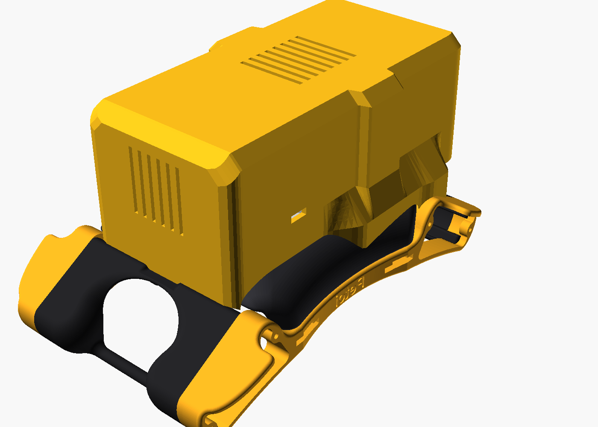
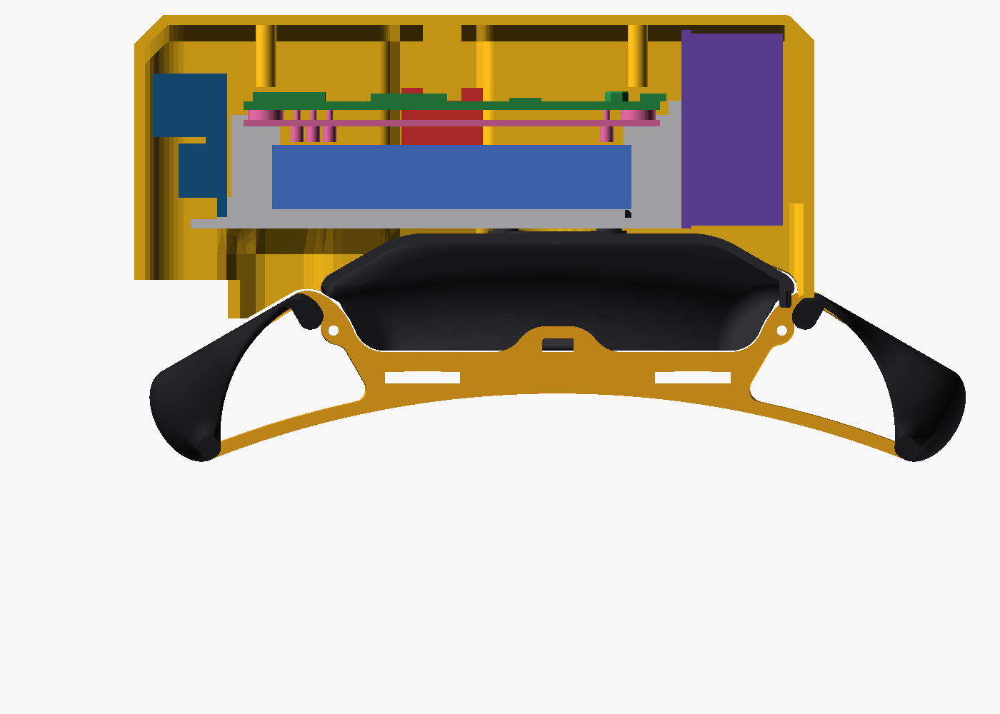

# Bittle X Pi Add-on v0.9 - Build Guide

Version 0.9, 2026-10-14. A sample add-on for the Bittle X platform v1.1 (../bittle_platform). It carries a Raspberry Pi Zero 2 W with a PiSugar 2 (1200 mAh), an NS4168 I2S amp with a 3 W speaker, and an SPH0645 I2S mic. It clicks onto the platform pegs. No tools, glue, tape or supports are necessary.

## 1. Parts to print

| File (stl/print/) | Material | Orientation | Supports | Cura profile | Mass |
|---|---|---|---|---|---|
| pod_tray.stl | PLA or PETG | floor on the bed | none | Bittle Pi Pod - PLA 0.25 | 12 g |
| pod_lid.stl | PLA | upside down: flat top on the bed | none | Bittle Pi Pod 0.25, or Bittle Fine 0.10 for the best surface | 35 g |
| usb_plug.stl (optional) | TPU | flange on the bed | none | TPU, 20 mm/s | 0.3 g |
| cover_pegs.stl (../bittle_platform) | PLA | stand on the rear end | tree, from the bed | Bittle Cover - PLA 0.25 | 11 g |

Print quality. Every surface of the add-on parts is at 45 deg or less from vertical, or is a short bridge:

1. Tray: 6 mm² of overhang in total. These are the flat bottoms (1.0 wide) of the amp pins. The speaker pins have a 45 deg point at the bottom.
2. Lid: 71 mm² in total. These are the tops (in the print) of the charge window, the switch slot and the button slit: bridges of 7 to 9 mm. The profiles have the bridge settings on.
3. The mic holes in the left lid wall are diamonds, so they print clean without a bridge.
4. The slots for the mic board and the speaker ear plate are vertical in the print. They have no ceilings.
5. Keep the seam at the back (the profiles do this).

## 2. Electronics

| Part | Notes |
|---|---|
| Raspberry Pi Zero 2 W | No header. Solder the wires to the pads, flat along the GPIO edge. |
| PiSugar 2, 1200 mAh | Under the Pi (pogo pins and its screws). The charge port, button and switch face the right side. |
| NULLLAB NS4168 I2S amp | 38.4 x 22.4 mm board, on edge, crosswise behind the stack, on two pins. Components to the rear. |
| NULLLAB 3 W 4 ohm speaker | Ear plate 45 x 31 x 1.5, body 27 x 30 x 14.3 (ruler). On two pins at the front, sound to the front grille. |
| HiLetgo SPH0645 I2S mic | 16.7 x 12.7 x 1.8 board, on edge on the left side, beside the GPIO edge of the Pi, port to the left. Solder the wires at the top edge. |
| 5 Dupont jumpers | Straight plugs on the BiBoard header (GND, +5V, TX2, RX2) in the cover slot. |
| Petoi AI Vision Module (optional) | Stays in the head. Its Grove cable goes along the left side of the robot and through the slot in the left lid wall to the Pi. |

Balance. The add-on weighs about 118 g: the printed parts in PLA and typical masses of the electronics. Its center of mass is 9.3 mm behind the robot center, -0.2 mm right of the center line and 15 mm above the cover top. The speaker at the front balances the Pi stack. The masses are not weighed: put your own values in MASS_G in pod.py and run pod.py again.

## 3. Assembly

The 3D viewer shows each step with animation: [https://beetlebugorg.github.io/bittlex/viewer/#step=1](https://beetlebugorg.github.io/bittlex/viewer/#step=1). Each step below has a link to its view.

1. Print the platform cover and fit it on the robot in place of the stock cover. ([viewer step 2](https://beetlebugorg.github.io/bittlex/viewer/#step=2))
2. Solder the wires to the Pi, the amp and the mic (section 4).
3. Push the mic board down into the slot at the left side of the tray, port to the left, wire pads at the top. ([viewer step 5](https://beetlebugorg.github.io/bittlex/viewer/#step=5))
4. Push the amp onto its two pins behind the stack, components to the rear. ([viewer step 6](https://beetlebugorg.github.io/bittlex/viewer/#step=6))
5. Hang the speaker on the two pins of the front wall, ear plate to the rear. ([viewer step 7](https://beetlebugorg.github.io/bittlex/viewer/#step=7))
6. Put the Pi + PiSugar 2 stack into the tray, battery down, ports to the right. ([viewer step 8](https://beetlebugorg.github.io/bittlex/viewer/#step=8))
7. Put the tray on the cover 7 mm forward of its place, over the pegs. Push it 7 mm rearward until it clicks. ([viewer step 3](https://beetlebugorg.github.io/bittlex/viewer/#step=3)) ([viewer step 4](https://beetlebugorg.github.io/bittlex/viewer/#step=4))
8. Push the Dupont plugs onto the BiBoard header. Route the wires over the Pi. ([viewer step 9](https://beetlebugorg.github.io/bittlex/viewer/#step=9))
9. Optional camera: put the Grove cable through the slot in the left lid wall, behind the speaker. Solder its wires to the Pi (section 4). Leave slack for the head to turn.
10. Push the lid down until the 4 snaps engage. The lid also stops the tray from sliding forward. ([viewer step 10](https://beetlebugorg.github.io/bittlex/viewer/#step=10))
11. Optional: push the TPU plug into the charge window. ([viewer step 11](https://beetlebugorg.github.io/bittlex/viewer/#step=11))
12. To remove: pull the lid up, slide the tray 7 mm forward and lift it.

## 4. Wiring

| Signal | Pi Zero 2 W | To |
|---|---|---|
| UART TX / RX | GPIO14 pin 8 / GPIO15 pin 10 | BiBoard RX2 / TX2 |
| GND | pin 6 | BiBoard GND |
| I2S BCLK | GPIO18 pin 12 | amp BCLK and mic BCLK |
| I2S LRCLK | GPIO19 pin 35 | amp LRCLK and mic LRCL |
| I2S out / in | GPIO21 pin 40 / GPIO20 pin 38 | amp DIN / mic DOUT (mic SEL to GND) |
| Power | 5V pin 2, 3V3 pin 1, GND pin 9 | amp 5V, mic 3V. Do not connect BiBoard 5V to the Pi. |
| Speaker | - | amp + / - to the speaker |
| Camera I2C (Grove) | SDA GPIO2 pin 3, SCL GPIO3 pin 5, 3V3 pin 17, GND pin 14 | AI Vision Module Grove: SDA, SCL, VCC, GND |

## 5. Files

| File | Content |
|---|---|
| stl/print/ | the parts in print orientation |
| cad/pod_tray.step, cad/usb_plug.step | exact CAD (the lid is a mesh: its lower edge follows the robot) |
| cad/assembly_step.zip | one STEP file with the robot, the platform and the add-on in place, with named and colored parts. Unzip it and open it in FreeCAD or other CAD software |
| stl/installed/, stl/models/ | the parts and the electronics in the robot frame |
| pod.py | all dimensions, the build and the checks (fit, slide path, loose pieces, overhang) |
| render.py, docs.py | the pictures and this guide |

The PiSugar 2 ports are about 12 mm inside the right lid wall: the stack is on the center line for balance. Use a micro-USB cable with a plug body of 11 x 7 mm or less. Move the switch with a pen tip through its slot.

Open items: the speaker sound face is assumed opposite the ears. The mic port is assumed at the board center; the 7 holes cover ±2.2 mm. The camera supply voltage is not checked: if the module needs 5 V, use pin 4. The BiBoard header height is an estimate (a photo of the robot shows it lower, so there is more room).

## 6. License

The printed parts, the drawings and this guide are CC BY 4.0, and the code is MIT (Jeremy Collins). The Pi Zero and PiSugar 2 fit models are from github.com/PiSugar/PiSugar (GPL-3.0). The Petoi parts are from github.com/PetoiCamp/NonCodeFiles, without a stated license. LICENSE.md and ATTRIBUTION.md in the repository give the details.

