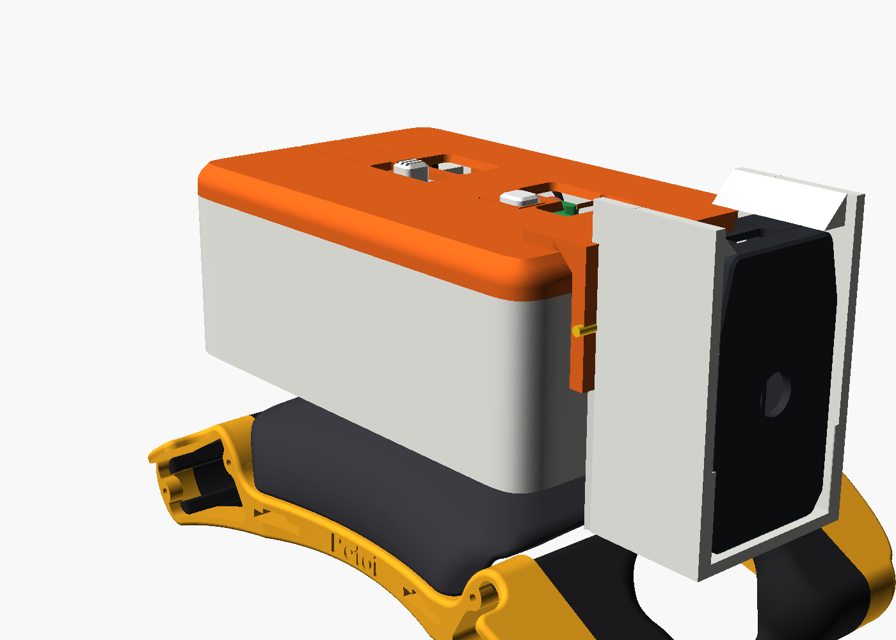
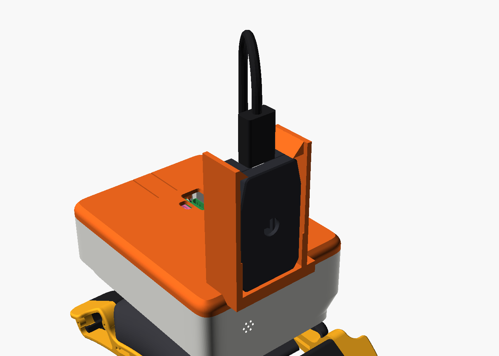

# Bittle X Pi Add-on v0.23 - Build Guide

Version 0.23, 2026-10-16. A sample add-on for the Bittle X platform v3.2 (../bittle_platform). It holds a Raspberry Pi Zero 2 W with a PiSugar 2 (1200 mAh), an NS4168 I2S amp with a 3 W speaker, an SPH0645 I2S mic and the Petoi AI Vision Module. The case is one rounded box (the body) and a slide-on top panel. The body clicks onto the platform pegs, and every part goes in from the top. No tools or supports are necessary; a dab of glue sets the amp.

## 1. Parts to print

| File (stl/print/) | Material | Orientation | Mass |
|---|---|---|---|
| pod_body.stl | PLA | floor on the bed | 40 g |
| pod_panel.stl | PLA, second color | upside down: top on the bed | 16 g |
| pod_button.stl | PLA, white | upside down: top on the bed | 0.1 g |
| pod_logo_white.stl, pod_logo_red.stl | PLA, white and red | top on the bed (as in the STL) | 0.1 g each |
| pod_camera_mount.stl | PLA, second color | on its back end (as in the STL) | 8 g |
| cover_pegs_foot.stl (../bittle_platform) | PLA | stand on the rear end | 11 g |
| Head off (optional): pod_camera_base_low.stl | PLA, second color | upside down (as in the STL) | 4 g |
| Head off (optional): pod_camera_cradle_low.stl | PLA, white | on its rear edges (as in the STL) | 9 g |

Print every part with the Cura profile "Bittle X" (../cura/Bittle_X.curaprofile; 0.20 mm layers, no supports, 6-line brim). ../cura/install_profiles.py installs it, and a copy with the size compensation of each spool that the tolerance app measured ("Bittle X - <spool>"). No part needs supports.

Print quality. The body and panel walls are 2.0 mm: with the offsets of the body profile, Cura slices 4 full lines of 0.5 mm. The body walls are vertical and its floor is on the bed. The only overhangs (40 mm² in total) are the flat undersides of the two amp nubs (1.5 x 4 mm). The grille holes and the mic holes are teardrops (round, with a 45 deg point on top), so they print without bridges. The panel top edge round ends in a 45 deg chamfer at the bed, the port openings have 45 deg chamfers, and the lid hooks and the lugs in the body have 45 deg faces. The latch tongue bends along the layers of the panel. Its overhangs (227 mm²) are short bridges at the button arm and the lid hooks. The camera mount has short bridges at the clip hooks and a 45 deg chin; the hooks over the case are 45 deg wedges. The cradle of the head-off mount stands on its dovetail tabs: its floor is a 30 mm bridge 1.4 mm over the bed. Keep the seam at the rear.

## 2. Electronics

| Part | Place |
|---|---|
| Raspberry Pi Zero 2 W + PiSugar 2, 1200 mAh | On the long edge over the robot center, 4.9 mm left of the center line so the battery is near it: ports and PiSugar controls up, GPIO header down to the left (toward the BiBoard), SD card to the rear. Two end posts hold the boards in one groove, the same depth for both boards; the M2.5 screw heads go down channels in the posts. The pin-fin heatsink on the SoC points into the left well (14 x 14 x 6.5 mm, estimated). |
| Dupont jumpers | Female-female jumpers: 3 to the BiBoard, 6 to the mic (2 of them through the splices). 10 cm, but 15 cm for the mic GND and 3V. |
| NULLLAB NS4168 I2S amp | 38.4 x 22.4 mm board, on edge along the right wall, parts to the inside, in a slot bar on the floor, upright with its screw terminal at the top. Two nubs hold its top edge. Its PH2.0 connectors are side entry: the I2S cable plugs in at the front end, the speaker at the rear end. |
| NULLLAB 3 W 4 ohm speaker | At the rear, sound to the grille in the rear face. Body 27.9 wide, 15.2 deep. Two tapered wings (44 across, 3 thick) at the middle of the body depth stand in two side grooves. |
| HiLetgo SPH0645 I2S mic | 12.45 x 16.12 board, high on the right wall near the front, port to the wall (holes in the right side). Its straight 6-pin header is along its front edge: the plugs point inward, and the wires go straight across behind the front wall. 3V is the lowest pin, SEL the highest. It drops into a slot in a post (rear edge) and a ledge (bottom edge); a fork under the panel holds its top edge. No tools. |
| Petoi AI Vision Module | In its Petoi case, vertical on the camera mount at the front of the panel, lens forward over the head, USB port at the top. It stands 9 mm right of the center line: it is then clear of the PiSugar charge port and the Pi power port. Two side brackets hold the case; a hook on each snaps over a top corner of the case, clear of the USB port. The case cannot lift out. |
| USB cable, USB-C to micro-USB | From the USB-C port in the top of the camera, an arch rearward over the panel, down into the Pi data USB port. Modeled length 113 mm between the plugs. |

Balance. The add-on weighs 133 g with the camera (weighed parts; printed parts at 50 % fill). Its center of mass is 1.7 mm behind the robot center and 1.3 mm right of the center line, 25 mm above the cover top. With the add-on, the center of mass of the robot is about 4 mm behind the midpoint of the front and rear paws (110 mm apart), and on the center line. The side is the limit when the robot tips: keep heavy parts low. Put your own masses in MASS_G in pod.py and run pod.py again.

## 3. Assembly

The 3D viewer shows each step with animation: [https://beetlebugorg.github.io/bittlex/viewer/#step=1](https://beetlebugorg.github.io/bittlex/viewer/#step=1). Labels are cut into the inside of the body: MIC, AMP, SPEAKER and BIBOARD where each part goes, PIN 1 and PIN 40 at the ends of the Pi header, and grooves in the floor for the amp cable lanes and the mic wire run.

1. Fit the platform cover in place of the stock cover. ([viewer step 2](https://beetlebugorg.github.io/bittlex/viewer/#step=2))
2. Put the empty body on the pegs 7 mm behind its place, grille to the rear. Slide it 7 mm forward until it clicks (about 3.2 N). The BiBoard header is now in the notch at the front of the left well. ([viewer step 3](https://beetlebugorg.github.io/bittlex/viewer/#step=3)) ([viewer step 4](https://beetlebugorg.github.io/bittlex/viewer/#step=4))
3. Push the speaker down into the two side grooves at the rear, body to the rear. ([viewer step 5](https://beetlebugorg.github.io/bittlex/viewer/#step=5))
4. Plug the six mic jumpers onto the mic header: 15 cm jumpers on GND and 3V. Drop the mic into the slots in the post and the ledge on the right wall near the front, port to the wall, header at the front. The panel holds it later. ([viewer step 6](https://beetlebugorg.github.io/bittlex/viewer/#step=6))
5. Plug the amp cable into the I2S connector at the front end of the amp and the speaker into its rear end. Put the bottom edge of the amp into the slot along the right wall, parts to the inside, tilt its top edge under the two nubs, and set it with a dab of glue. Lay the amp cable across the floor in front of the front pegs, into the left well. ([viewer step 7](https://beetlebugorg.github.io/bittlex/viewer/#step=7))
6. Push the Pi + PiSugar 2 stack down into the end grooves, over the amp cable. ([viewer step 8](https://beetlebugorg.github.io/bittlex/viewer/#step=8))
7. Plug the wires one at a time, in the order of section 5: the amp cable, the splices, the Pi ends of the BiBoard jumpers, the mic jumpers, then the BiBoard ends. The viewer has one step for each wire. ([viewer step 9](https://beetlebugorg.github.io/bittlex/viewer/#step=9)) ([viewer step 21](https://beetlebugorg.github.io/bittlex/viewer/#step=21))
8. Press the post of the white button cap into the round hole in the panel tongue until the cap sits flat. It stays in the panel. Glue the two logo inlays into the pocket in the panel top, behind the camera: the white ring and M at the left, the red ring and J at the right. ([viewer step 22](https://beetlebugorg.github.io/bittlex/viewer/#step=22))
9. Put the panel down 5 mm behind its place, then slide it forward until the latch clicks (about 5.7 N). The hooks under the panel go under the lugs in the walls. ([viewer step 23](https://beetlebugorg.github.io/bittlex/viewer/#step=23))
10. Push the two clip legs of the camera mount down through the window until they click. Push the camera case down between the brackets, lens forward and USB port up, until the hooks click over its top. ([viewer step 24](https://beetlebugorg.github.io/bittlex/viewer/#step=24)) ([viewer step 25](https://beetlebugorg.github.io/bittlex/viewer/#step=25))
11. Plug the USB-C end of the cable into the top of the camera and the micro-USB end into the Pi data USB port. The cable arches rearward over the panel. ([viewer step 26](https://beetlebugorg.github.io/bittlex/viewer/#step=26))
12. Open: lift the rear edge of the panel at the finger notch (about 3.1 N), slide the panel 5 mm rearward and lift it. Remove: open the panel, pull the BiBoard plugs off, slide the body 7 mm rearward and lift it.

On the top: the port openings are shaped to the plug bodies (plug + 0.4 mm). The Pi power port and the PiSugar charge port share one opening, behind the camera. The window beside the HDMI opening shows the PiSugar power switch: move its lever with a fingernail. The tongue in the middle of the panel is a large button: press it to press the PiSugar button.

Head off (optional). Without the Petoi head, the camera can stand lower, in front of the body: pod_camera_base_low clips into the camera window as the camera mount does, and its front plate hangs down the front of the body. Slide the two dovetail tabs of pod_camera_cradle_low down into its grooves until the cradle sits on the top of the base. Push a 1.75 mm filament piece through the pin hole on each side. Push the camera down into the cradle until the hooks click. Plug the USB cable into the top of the camera and into the Pi data USB port.

## 4. Wiring

| Board pin | Pi pin | Signal |
|---|---|---|
| BiBoard TX2 / RX2 / GND | 10 / 8 / 6 | RXD / TXD / GND (TX and RX cross). BiBoard +5V: not wired |
| Amp V / G | 2 / 14 | 5V / GND |
| Mic 3V / GND / SEL | 1 / 9 / 39 | 3V3 / GND / GND (left channel) |
| Amp BCLK + mic BCLK | 12 (splice) | GPIO18: one wire from the pin to a soldered splice, then one wire to each board |
| Amp LRC + mic LRCL | 35 (splice) | GPIO19: the same, a second splice |
| Amp DIN / mic DOUT | 40 / 38 | GPIO21 / GPIO20 |
| Speaker | - | amp 2-pin PH2.0 at the rear end of the amp |

Pin map from the wiring blueprint (reference/g2-wiring-blueprint.html; that blueprint wins if they differ). PiSugar 2 touches pins 2, 4, 5 and 6 from below with its pogo pins. Pins 11, 17-20 and 22-24 are kept free for a screen.

## 5. Cable routing

The BiBoard and mic wires are female-female jumpers from a pack of 10 cm wires; the mic GND and 3V jumpers are 15 cm. The amp keeps its own cable, and the two splices are cut from pack jumpers. pod.py models every wire (1.4 mm) at its real length and checks it: no wire touches a printed part or a board, no two wires pass through each other (0 found), and no bend is smaller than 2 mm radius (1.35 mm in the slack). A pack jumper is longer than its route, so its excess is an arch or a coil (a service loop) in free space. The pages below show each module: its pins, then its wires in the case.

| # | From | To (excess) | mm | # | From | To (excess) | mm |
|---|---|---|---|---|---|---|---|
| 1 | BiBoard TX2 | pin 10 (2-turn loop) | 100 | 11 | mic DOUT | pin 38 (1-turn loop on a 5 mm stem) | 97 |
| 2 | BiBoard RX2 | pin 8 (arch) | 98 | 12 | mic BCLK | BCLK splice | 76 |
| 3 | BiBoard GND | pin 6 (1-turn loop) | 99 | 13 | mic GND | pin 9 (2-turn loop) | 149 |
| 4 | amp G | pin 14 | 92 | 14 | mic 3V | pin 1 (2-turn loop) | 148 |
| 5 | amp V | pin 2 | 109 | 15 | BCLK splice | pin 12 | 18 |
| 6 | amp BCLK | BCLK splice | 91 | 16 | LRCLK splice | pin 35 | 7 |
| 7 | amp LRC | LRCLK splice | 78 | 17 | amp speaker + | speaker + | 43 |
| 8 | amp DIN | pin 40 | 66 | 18 | amp speaker - | speaker - | 44 |
| 9 | mic SEL | pin 39 (1-turn loop) | 100 | 19 | camera USB-C | Pi data USB | 113 |
| 10 | mic LRCL | LRCLK splice | 62 |  |  |  |  |

Plug the jumpers one at a time, in this order. Each wire goes to its place before the next one, so the later wires lie over the earlier ones:

1. #1: BiBoard TX2 to pin 10. Put its excess in a 2-turn loop as in the drawing.
2. #2: BiBoard RX2 to pin 8. Put its excess in a arch as in the drawing.
3. #3: BiBoard GND to pin 6. Put its excess in a 1-turn loop as in the drawing.
4. #14: mic 3V to pin 1. Put its excess in a 2-turn loop as in the drawing.
5. #13: mic GND to pin 9. Put its excess in a 2-turn loop as in the drawing.
6. #12: mic BCLK to BCLK splice. Cut to length.
7. #11: mic DOUT to pin 38. Put its excess in a 1-turn loop on a 5 mm stem as in the drawing.
8. #10: mic LRCL to LRCLK splice. Cut to length.
9. #9: mic SEL to pin 39. Put its excess in a 1-turn loop as in the drawing.
10. Last, push the BiBoard ends of #1, #2 and #3 onto the BiBoard header.

1. The mic has a straight header along its front edge. Plug the six mic jumpers onto it before the mic goes in. Mic wires: straight inward out of the mic plugs, across behind the front wall in front of the stack, then rearward as a flat stack in the left well beside the BiBoard plugs; each wire stays at the height of its pin.
2. Amp cable: out of the plug the wires fan out inward (G nearest the wall), forward, down, across the floor in front of the front pegs (under the stack), then rearward in a floor lane of the left well; DIN goes up at once. Lay it before the stack goes in. Its own excess (not measured) folds in the right gallery over the amp.
3. Splices: the LRCLK splice stands beside the BiBoard plugs, the BCLK splice at the middle of the left well.
4. The BiBoard wires go in first, from the lowest: TX2, RX2, then GND. Their BiBoard ends go on last: a Pi housing for the mic slides off its pin past them.
5. The mic wires go in from the lowest of the stack: 3V, GND, BCLK, DOUT, LRCL, then SEL.

## 6. Checks

1. Slide: the empty body is clear of the robot at the click point, half way and at the drop-on place. The clicks are about 3.2 N to lock and 3.2 N to unlock (beam strain 0.9 %).
2. Panel: it goes down 5 mm behind its place and slides forward without contact. The latch tongue lifts 0.8 mm over the rib: about 5.7 N to slide on, 3.1 N to lift, strain 0.6 %. Lifted 0.3 mm, the hooks touch the lugs. Turned 180 deg, the panel does not go down.
3. Install: the speaker and the stack each go straight down 40 mm without contact. The mic drops into its slots; the post, the ledge, a stop and the panel fork hold it on every side. The amp tilts in under its nubs. Each wire, in its order, goes in from 40 mm above without contact with the parts and wires already in place (small contacts of 2 to 3 mm³ stay where a wire slides under a loose service loop). Each Dupont housing slides off its pin without contact.
4. Camera: the case goes into the mount without contact and is clear of the port plugs. Lifted 0.3 mm, its top hits the hooks. The brackets spread 4.8 mm as the case goes in (about 0.5 % strain). The clip leg hooks catch 0.8 mm under the frame on a 10 deg barb, so a pull pushes them out; the legs bend to 1.9 % strain. The USB cable touches no part and no other wire. The head turns without contact with the mount and the cable.
5. Head-off mount: the base, the cradle, the camera and its cable touch no part of the robot without its head. The cradle slides down into the grooves without contact; the pins stop it from lifting.
6. Switch and button: the switch lever is under the window over its full travel. The button arm is 0.2 mm over the button; pressed 0.6 mm, it pushes the button.
7. Robot: the head turns from -85 to 85 deg without contact. 18 front and 36 rear leg poses (of 504) touch the add-on, only when a thigh swings up over the back. The Petoi tail is 3.2 mm under the add-on, and 0.05 mm at the drop-on place.

Open items: the BiBoard header height is an estimate (measure it). The speaker size is a ruler measurement. The mic port is assumed at the board center; the 7 holes cover ±2.2 mm. The SD card is assumed 2.5 mm out of its holder. The heatsink and the screw heads (4.6 x 1.8 mm) are estimates. The camera hooks catch the top of the case of the STL. To change the SD card, lift the stack out. The Pi power port and the PiSugar charge port are side by side: use one of them at a time.

## 7. Files and license

| File | Content |
|---|---|
| stl/print/ | the parts in print orientation |
| cad/*.step | the parts as STEP (from the mesh) |
| cad/assembly_step.zip | one STEP file with the robot, the platform and the add-on in place, with named and colored parts |
| stl/installed/, stl/models/ | the parts and the electronics in the robot frame |
| pod.py, motion.py, render.py, docs.py | dimensions, build and checks; robot motion; pictures; this guide |

The printed parts, the drawings and this guide are CC BY 4.0, and the code is MIT (Jeremy Collins). The Pi Zero and PiSugar 2 fit models are from github.com/PiSugar/PiSugar (GPL-3.0). The Petoi parts are from github.com/PetoiCamp/NonCodeFiles, without a stated license. LICENSE.md and ATTRIBUTION.md in the repository give the details.

