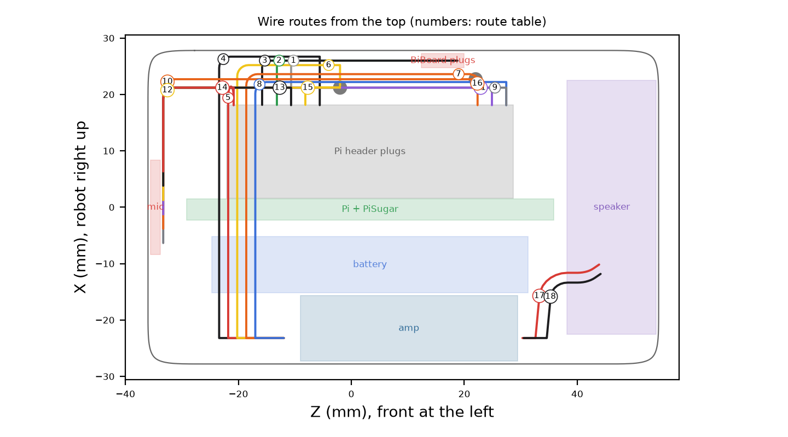
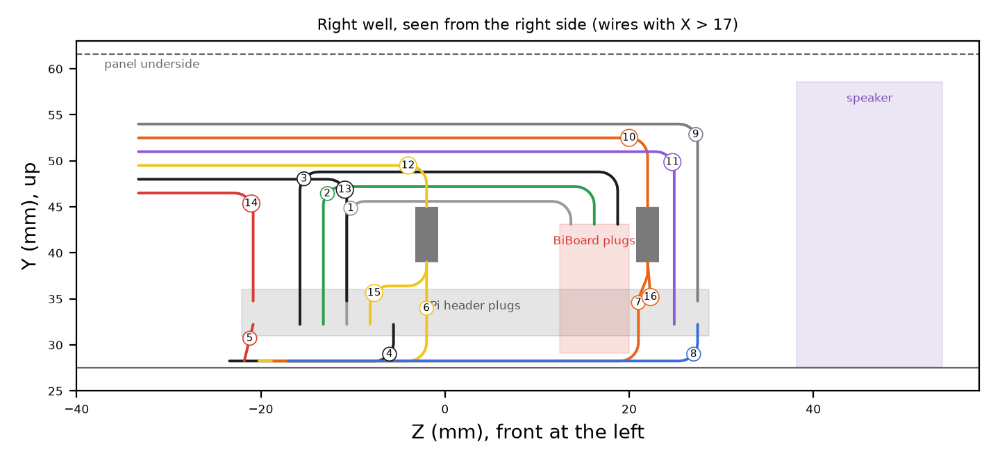

# Bittle X Pi Add-on v0.16 - Build Guide

Version 0.16, 2026-10-15. A sample add-on for the Bittle X platform v3.1 (../bittle_platform). It holds a Raspberry Pi Zero 2 W with a PiSugar 2 (1200 mAh), an NS4168 I2S amp with a 3 W speaker, and an SPH0645 I2S mic. The case is one rounded box (the body) and a snap-in top panel. The body clicks onto the platform pegs, and every part goes in from the top. No tools, glue, tape or supports are necessary.

## 1. Parts to print

| File (stl/print/) | Material | Orientation | Supports | Cura profile | Mass |
|---|---|---|---|---|---|
| pod_body.stl | PLA | floor on the bed | none | Bittle Pi Pod - PLA 0.25 | 32 g |
| pod_panel.stl | PLA, second color | upside down: top on the bed | none | Bittle Fine 0.10 for the best top | 13 g |
| pod_switch.stl | PLA | flat side on the bed, tab up | none | Bittle Fine 0.10 | 0.2 g |
| cover_pegs_foot.stl (../bittle_platform) | PLA | stand on the rear end | none: the foot is the support | Bittle Cover - PLA 0.25 | 11 g |

Print quality. The body walls are vertical and its floor is on the bed. The only overhangs (30 mm² in total) are the tops of the two cable notches at the base of the side walls: 8 mm bridges. The front cable notches are 45 deg chamfers. The grille holes and the mic holes are teardrops (round, with a 45 deg point on top), so they print without bridges. The panel top edge round ends in a 45 deg chamfer at the bed, the port openings have 45 deg chamfers, and the snap bumps have 45 deg catch faces. Its only overhang (4 mm²) is the 2 mm bridge of the button arm. The slider has a 1.7 mm bridge over the fork. Keep the seam at the rear.

## 2. Electronics

| Part | Place |
|---|---|
| Raspberry Pi Zero 2 W + PiSugar 2, 1200 mAh | On the long edge over the robot center: ports and PiSugar controls up, GPIO header down to the right, SD card to the front. Two end posts with grooves hold the boards. |
| Dupont jumpers | On the soldered Pi header, 12 pins (section 4). 3 of them go to the BiBoard header in the right well. |
| NULLLAB NS4168 I2S amp | 38.4 x 22.4 mm board, on edge along the left wall, parts to the inside, in a slot bar on the floor. Its PH2.0 connectors are side entry: the I2S cable plugs in at the front end, the speaker at the rear end. |
| NULLLAB 3 W 4 ohm speaker | At the rear, sound to the grille in the rear face. Ear plate 45 x 31 x 1.5 in two side grooves (ruler). |
| HiLetgo SPH0645 I2S mic | 16.7 x 12.7 x 1.8 board at the front wall, port to the front, in two grooves. Solder the wires to the pins at its top edge. |
| Head camera cable | The Grove cable comes out under the front edge of the cover (left side) and runs up to the head. A 45 deg notch in each front bottom corner of the body gives it room. |
| Optional cable | A notch at the base of each side wall lets a cable in from outside. |

Balance. The add-on weighs about 116 g (printed parts in PLA and typical masses of the electronics, not weighed). The Pi stack, the heaviest part, is over the robot center. The speaker is at the rear, away from the mic. So the center of mass of the add-on is 13.5 mm behind the robot center and 2.6 mm left of the center line, 19 mm above the cover top. The platform spec recommends 10 mm or less: with the speaker at the front it is about 7 mm. Put your own masses in MASS_G in pod.py and run pod.py again.

## 3. Assembly

The 3D viewer shows each step with animation: [https://beetlebugorg.github.io/bittlex/viewer/#step=1](https://beetlebugorg.github.io/bittlex/viewer/#step=1).

1. Fit the platform cover in place of the stock cover. ([viewer step 2](https://beetlebugorg.github.io/bittlex/viewer/#step=2))
2. Put the empty body on the pegs 7 mm behind its place, grille to the rear. Slide it 7 mm forward until it clicks (about 4.2 N). The BiBoard header is now in the notch of the right well. ([viewer step 3](https://beetlebugorg.github.io/bittlex/viewer/#step=3)) ([viewer step 4](https://beetlebugorg.github.io/bittlex/viewer/#step=4))
3. Push the speaker down into the two side grooves at the rear, body to the rear. ([viewer step 5](https://beetlebugorg.github.io/bittlex/viewer/#step=5))
4. Push the mic down into the two grooves at the front wall, port to the front. ([viewer step 6](https://beetlebugorg.github.io/bittlex/viewer/#step=6))
5. Plug the amp cable into the I2S connector at the front end of the amp and the speaker into its rear end. Push the amp down into the slot along the left wall, parts to the inside. Lay the amp cable across the floor in front of the front pegs. ([viewer step 7](https://beetlebugorg.github.io/bittlex/viewer/#step=7))
6. Push the jumpers onto the Pi header. Push the Pi + PiSugar 2 stack down into the end grooves, over the I2S wires. ([viewer step 8](https://beetlebugorg.github.io/bittlex/viewer/#step=8))
7. Reach into the right well and push the three Dupont plugs onto the BiBoard header (TX2, RX2, GND). Fold the slack into the right well. ([viewer step 9](https://beetlebugorg.github.io/bittlex/viewer/#step=9))
8. Put the switch slider on the PiSugar switch lever, fork down. ([viewer step 10](https://beetlebugorg.github.io/bittlex/viewer/#step=10))
9. Push the panel straight down until the 4 tabs click (about 9.1 N). It fits one way only. The slider tab comes up through its slot. ([viewer step 11](https://beetlebugorg.github.io/bittlex/viewer/#step=11))
10. Open: lift the rear edge of the panel at the finger notch (about 8 N), then the front. Remove: open the panel, pull the BiBoard plug off, slide the body 7 mm rearward and lift it.

On the top: the port openings are shaped to the plug bodies (plug + 0.4 mm). The Pi power port and the PiSugar charge port share one opening. The ribbed slider beside the HDMI opening moves the PiSugar power switch (2 mm of slot travel each way; the switch sets the end positions). The tongue near the front of the panel is a large button: press it to press the PiSugar button.

## 4. Wiring

| Board pin | Pi pin | Signal |
|---|---|---|
| BiBoard TX2 / RX2 / GND | 10 / 8 / 6 | RXD / TXD / GND (TX and RX cross). BiBoard +5V: not wired |
| Amp V / G | 2 / 14 | 5V / GND |
| Mic 3V / GND / SEL | 1 / 9 / 39 | 3V3 / GND / GND (left channel) |
| Amp BCLK + mic BCLK | 12 (splice) | GPIO18: one wire from the pin to a soldered splice, then one wire to each board |
| Amp LRC + mic LRCL | 35 (splice) | GPIO19: the same, a second splice |
| Amp DIN / mic DOUT | 40 / 38 | GPIO21 / GPIO20 |
| Speaker | - | amp 2-pin PH2.0 at the rear end of the amp |

Pin map from the wiring blueprint (reference/g2-wiring-blueprint.html; that blueprint wins if they differ). PiSugar 2 touches pins 2, 4, 5 and 6 from below with its pogo pins. Pins 11, 17-20 and 22-24 are kept free for a screen.

## 5. Cable routing

pod.py models every wire (1.4 mm) on its route and checks it: no wire touches a printed part or a board, no two wires pass through each other (0 found), and no bend is smaller than 2 mm radius. The drawings show the routes. The numbers are the rows of the table.

| # | From | To | mm | # | From | To | mm |
|---|---|---|---|---|---|---|---|
| 1 | BiBoard TX2 | pin 10 | 46 | 10 | mic LRCL | LRCLK splice | 99 |
| 2 | BiBoard RX2 | pin 8 | 54 | 11 | mic DOUT | pin 38 | 110 |
| 3 | BiBoard GND | pin 6 | 62 | 12 | mic BCLK | BCLK splice | 62 |
| 4 | amp G | pin 14 | 104 | 13 | mic GND | pin 9 | 60 |
| 5 | amp V | pin 2 | 72 | 14 | mic 3V | pin 1 | 45 |
| 6 | amp BCLK | BCLK splice | 96 | 15 | BCLK splice | pin 12 | 13 |
| 7 | amp LRC | LRCLK splice | 111 | 16 | LRCLK splice | pin 35 | 8 |
| 8 | amp DIN | pin 40 | 107 | 17 | amp speaker + | speaker + | 38 |
| 9 | mic SEL | pin 39 | 121 | 18 | amp speaker - | speaker - | 38 |

1. Mic wires: bend each wire before you solder it, so it leaves along the back face of the board. Cut them to the route length + 15 mm. Route: up the back of the mic, right over the front post, rearward down the right well; the lowest wire leaves first.
2. Amp cable: forward from the plug, down, across the floor in front of the front pegs (under the stack), then rearward in a floor lane of the right well. From the front: DIN in the inner lane, then LRC, BCLK, and G at the wall. V goes up to pin 2 at once. Lay it before the stack goes in.
3. Splices: the BCLK splice stands in front of the BiBoard notch, the LRCLK splice beside the BiBoard plugs. The Pi wire and the amp wire go into the bottom, the mic wire into the top.
4. BiBoard wires: right well: along the floor to the right wall, up, rearward over the BiBoard plugs (each wire at its own height), down into them. Pin 6 (front) goes to GND (rear), so the order turns over: pin 10 runs lowest, pin 6 highest.
5. Speaker leads: a pair: up the left side behind the amp, over the ear plate, into the top of the speaker.
6. Jumpers are longer than the routes. Fold the slack in the right well above the floor lanes, away from the finger space over the BiBoard plugs.

## 6. Checks

1. Slide: the empty body is clear of the robot at the click point, half way and at the drop-on place. The clicks are about 4.2 N to lock and 4.2 N to unlock (beam strain 1.12 %).
2. Panel tabs: 9.1 N to close (4 tabs, 30 deg lead), 8 N to open one end (2 tabs, 45 deg catch), tab strain 1.19 %. Turned 180 deg, the panel does not go down.
3. Install: the speaker, the mic, the amp and the stack each go straight down 40 mm without contact. The panel goes down without contact.
4. Switch and button: the slider moves 2 mm each way without contact, and its fork pushes the lever after 0.3 mm. The button arm is 0.2 mm over the button; pressed 0.6 mm, it pushes the button.
5. Robot: the head turns from -85 to 85 deg without contact. 6 front and 22 rear leg poses (of 504) touch the add-on, only when a thigh swings up over the back. The Petoi tail is 3.2 mm under the add-on, and 0.05 mm at the drop-on place.

Open items: the BiBoard header height is an estimate (measure it). The speaker size is a ruler measurement. The mic port is assumed at the board center; the 7 holes cover ±2.2 mm. The SD card is assumed 2.5 mm out of its holder. To change the SD card, lift the stack out. The Pi power port and the PiSugar charge port are side by side: use one of them at a time.

## 7. Files and license

| File | Content |
|---|---|
| stl/print/ | the parts in print orientation |
| cad/pod_body.step, cad/pod_panel.step | the parts as STEP (from the mesh) |
| cad/assembly_step.zip | one STEP file with the robot, the platform and the add-on in place, with named and colored parts |
| stl/installed/, stl/models/ | the parts and the electronics in the robot frame |
| pod.py, motion.py, render.py, docs.py | dimensions, build and checks; robot motion; pictures; this guide |

The printed parts, the drawings and this guide are CC BY 4.0, and the code is MIT (Jeremy Collins). The Pi Zero and PiSugar 2 fit models are from github.com/PiSugar/PiSugar (GPL-3.0). The Petoi parts are from github.com/PetoiCamp/NonCodeFiles, without a stated license. LICENSE.md and ATTRIBUTION.md in the repository give the details.

