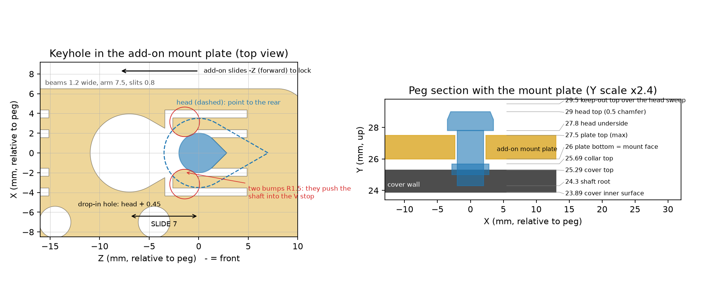
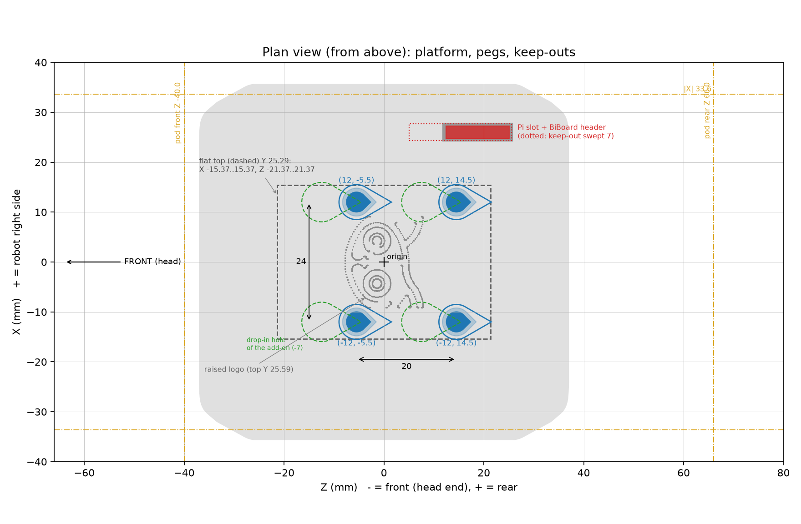
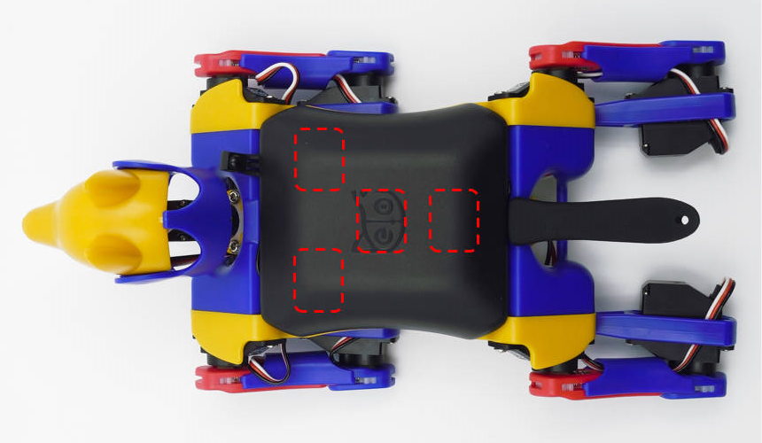

# Bittle X Platform v3.0 - Interface Specification

Version 3.0, 2026-10-15. The platform is the stock Petoi Bittle X back cover with 4 teardrop pegs on its top. An add-on has a plate with 4 keyholes. Put it on the pegs, slide it 7 mm forward, and it clicks. To remove it, slide it 7 mm rearward and lift it. It comes off closed: the head is not in the way. The keyholes have the shape of the pegs, so the add-on goes on in one direction only. No tools, glue or tape are necessary. interface.json has all the numbers in machine-readable form.

Version 3.0 is not compatible with earlier versions: the pegs have a new shape and place, and the slide goes the other way. Print the cover and the add-on plates again.

## 1. Key numbers

| Item | Value (mm) |
|---|---|
| Frame | X lateral (+X = robot right), Y up, Z along the body (-Z = head end). Origin: center line, middle of the cover. |
| Pegs (X, Z) | (12, -5.5), (12, 14.5), (-12, -5.5), (-12, 14.5): a centered 24 x 20 rectangle |
| Peg | teardrops with the point to the rear (+Z). Head: R3.5, point 60 deg, Y 27.8 to 29. Shaft: R2, point 90 deg |
| Add-on plate | bottom at Y 26, 1.5 thick at the keyholes |
| Keyhole | drop-in hole 7 mm in front of the peg = the head teardrop + 0.45; slot 4.7 wide back to a V stop at the peg; 0.4 lead-in chamfers top and bottom |
| Fit | put the add-on on 7 mm behind its place, then slide it 7 mm forward until it clicks. Remove: slide it rearward and lift |
| Click (detent) | two 1.2 wide spring beams, one on each side of each slot, freed by 0.8 U slits (fixed at the rear end only). Bumps R1.5 at 1.42 in front of the peg, 0.35 into the shaft path. They push the shaft point into the V stop, which centers it. |
| Click force | about 4.2 N to slide on and 4.2 N to slide off (all 8 beams, PLA estimate); beam strain 1.12 % |
| Keep clear | the peg heads as they slide; the BiBoard header in the cover slot (X 24.73..27.27, Z 12.4..25.1, top Y 29.1) |
| Size | the pod fits in Z -40..66, \|X\| <= 33.6; outside that, check the legs and the head |

## 2. Design an add-on

1. Start from cad/starter_plate.step. It has the keyholes and the click beams.
2. Add your part on top of the plate, in the same print. You can also screw parts to the M3 holes.
3. Keep your part out of stl/installed/keepout.stl. This keeps it clear of the robot, the peg heads and the header.
4. Keep heavy parts low and near the pegs. Keep the center of mass of the add-on within 10 mm of Z 0, near X 0.
5. Keep the weight low and near the center line. The pegs carry the whole add-on.
6. For a plate of a different shape: subtract cad/keyhole_cutter.step, then add cad/detent_bumps.step. Both are in position.

## 3. Printing

| Part | Orientation | Supports | Cura profile |
|---|---|---|---|
| cover_pegs_foot (recommended) | stand on the rear end, foot on the bed | none: the foot is the support | Bittle Cover - PLA 0.25, brim off. Snap off the foot after the print. |
| cover_pegs (no foot) | stand on the rear end | tree, from the bed | Bittle Cover - PLA 0.25 (14-line brim) |
| starter_plate and add-ons | plate bottom on the bed | none | Bittle Pi Pod - PLA 0.25 |
| small, detailed parts | - | - | Bittle Fine - PLA 0.10 |

| Setting | 0.25 profiles | Fine 0.10 |
|---|---|---|
| Layer | 0.25 | 0.10 (first layer 0.25) |
| Walls / infill | 3 / 20 % gyroid | 3 / 20 % gyroid |
| Outer wall / inner wall / infill speed | 30 / 40 / 60 mm/s | 25 / 35 / 50 mm/s |
| Outer wall acceleration | 600 mm/s² | 500 mm/s² |
| Nozzle | 220 C (PLA) | 220 C (PLA) |

1. Material: PLA works. Use PETG for add-ons that you remove often or that get warm.
2. Standing on its end, the cover prints the pegs with layers along their length. This makes them strong. The shaft and collar points are down, so they need no supports.
3. The cover stands on a thin strip, and its center of mass is past that strip. The foot is a 3-layer plate with 7 fins under the leaning face. It increases the first layer from 53 to about 1000 mm². The fins touch the cover only at small teeth.
4. In add-ons, keep overhangs at 45 deg or less. Use chamfers, not round edges, on the bottom side.
5. The fits use 0.35 (slot), 0.45 (drop-in hole) and 0.3 (under the heads) clearance. Calibrate your printer if the plate does not slide on.

## 4. Files

| File | Content |
|---|---|
| stl/print/ | the parts to print, in print orientation |
| cad/starter_plate.step | the start point for an add-on |
| cad/pegs.step, keyhole_cutter.step, detent_bumps.step | the interface parts, in position (robot frame) |
| stl/installed/ | all parts and keepout.stl in the robot frame |
| interface.json / interface.py | all numbers |
| build.py, docs.py | rebuild the parts and this document (build123d, manifold3d) |

Open items: the BiBoard header height is an estimate from photos. The legs, the head and the robot balance are not modeled. The Petoi cover is a mesh, so cover_pegs is STL only.

## 5. Bittle X V2 back touch sensor

1. On a Bittle X V2, the back touch sensor is a flexible circuit that is glued to the inside of the cover top. It has touch areas on the left, the right, the center and near the tail (docs.petoi.com/extensible-modules/back-touch-sensor).
2. The peg roots stop inside the 1.4 mm wall, so the inside of the cover does not change. Move the circuit from the stock cover to cover_pegs in the same way as on the stock cover.
3. An add-on on the platform covers most of the touch areas. Disable the back touch mode (serial command Xb) when an add-on is on the robot.
4. For this reason, the platform has no parts under the cover top. A cover that prints flat without supports needs pegs held from inside the cover, where the circuit is. A later interface with sockets in a thicker top can avoid this.

## 6. License

The designs and this document are CC BY 4.0, and the code is MIT (Jeremy Collins). The cover, the side shoulder and the front plate are Petoi files from github.com/PetoiCamp/NonCodeFiles. Petoi publishes them without a stated license, and cover_pegs.stl is made from the Petoi cover. LICENSE.md and ATTRIBUTION.md in the repository give the details.

